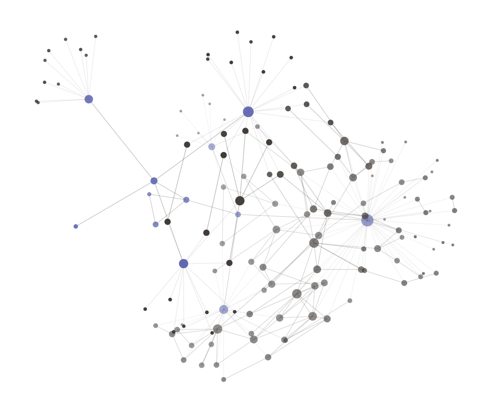

# Futures Friction Kit

Most AI tools are built to remove friction: a question goes in and an answer comes out. The Futures Friction Kit adds friction on purpose. It is a free knowledge kit that turns the AI assistant a media organisation already uses into a thinking partner for its innovation work, one that pauses before it answers. When someone brings it a plan or an idea, the assistant first helps them find the assumption about the future that the idea depends on, and then tests the idea against the different futures that could follow. It never says which future will arrive, and it leaves the ideas and the writing to the people whose decision it is.

The kit was developed by the Copenhagen Institute for Futures Studies and the Danish School of Media and Journalism in AI Medialab Denmark, together with Danish media organisations and experts from the media and tech industry, and funded by the Google News Initiative.

## Install

- **MCP**: connect your AI assistant to the kit online. Not available yet.
- **Skill**: for Claude and other AI tools that read skills.
- **Manual**: for any AI assistant with projects and file upload.

### Skill

1. On this page open the `installation-options` folder and download `futures-friction-kit-skill.zip`.
2. Add it to your AI tool as a skill. In Claude, upload the zip as a skill in the settings. In a tool that reads skills from a folder on your computer, such as Claude Code, unzip it into that folder, `.claude/skills/`.
3. Describe a decision you face. The kit loads by itself.

### Manual

1. On this page choose **Code**, then **Download ZIP**, and unzip it.
2. Create a project in your AI assistant.
3. Open the `bundle` folder. Copy all the text of `AGENTS.md` and paste it into the project's instructions. It tells the assistant what to read and when, and an uploaded file is only read when the assistant goes looking for it.
4. Upload everything else in the `bundle` folder: `persona.md`, `index.md` and the folders `canon` and `context`.
5. Describe a decision you face.

If your assistant limits how many files you can upload, download `futures-friction-kit-lite.zip` from the `installation-options` folder instead: paste `instructions.md` and upload `persona.md`, `canon.md` and `context.md`.

The logic of your AI system might change. If a step does not match, ask your AI.

## What is in the kit

The kit is a folder of plain text files in the Open Knowledge Format, and every one of them can be opened and read in the `bundle` folder on this page. It is arranged so that an AI opens only what a question needs: every folder has an index with one line for each file, and every file begins with a short header that says what kind of knowledge it holds, the claim it makes, when it helps and what it rests on.

```text
bundle/                    the kit itself
├── AGENTS.md              what the assistant reads first: what to open, and when
├── persona.md             who the assistant is and how it works
├── index.md               the map of everything below
├── canon/                 how CIFS thinks
│   ├── principles/
│   ├── methods/
│   └── concepts/
└── context/               what the world and the sector look like
    ├── megatrends/
    ├── signals/
    ├── sector/            what media organisations told us in interviews
    └── organisation/      empty, reserved for an organisation's own files

installation-options/      the same kit, packaged
├── futures-friction-kit-skill.zip   as a skill
└── futures-friction-kit-lite.zip    in three files, for assistants that limit uploads
```

The links inside the kit start from the `bundle` folder, which is how the assistant reads them, so they do not open on this page. Browse the folders instead.



Every dot is a file, and every line is one file leading to or resting on another. The blue dots are the files the assistant finds its way by.

## Add your organisation's own context

The kit arrives knowing futures methods and the media sector, and nothing about the organisation it is used in. Its questions become more specific once it knows what that organisation is and does today: its products and audiences, how it earns its money, the systems it depends on, and what earlier projects found. Plans and targets are a different thing. They belong in the conversation, where the assistant tests them, and not among the facts.

**If you installed the skill in a tool that works in a folder on your computer**, such as Claude Code, there is nothing to set up. Tell the assistant about your organisation, or hand it a document, in the middle of any conversation. It writes down what describes your organisation, with every detail you gave it, as files in a folder called `organisation`, and it tells you in one line what it kept. It keeps that folder next to your own work and not inside the kit, so replacing the kit with a newer copy never touches it. Each file is marked as written by an AI, with the date, so nobody mistakes it for something a person has checked. A plan, a draft, or anything you ask it not to keep stays in the conversation.

**If you installed it any other way**, upload your documents to the same project as the kit, or attach them to a conversation, and say in a sentence what they are. The assistant cannot save anything here, so it knows what you have uploaded and nothing more.

Share only what your organisation allows you to put into your AI tool.

## Licence

The assistant instructions are licensed under CC BY-NC 4.0: you may use and adapt them and share them free of charge, with credit. Selling the kit or an adapted version, or charging for access to it, requires prior written permission from CIFS. Reports, extracts and interview material have their own terms. The full terms are in `LICENCE.txt` in the kit.
